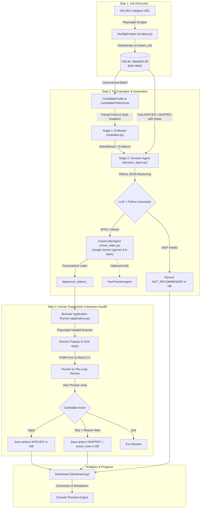

# Onboarding Guide: DEV.BG Job Agent (`cv_submitter`)

Welcome to the **DEV.BG Job Agent** (`devbg-job-agent`) codebase! This document serves as the comprehensive engineering guide and onboarding reference covering the end-to-end architecture, multi-model AI strategy, data schemas, setup steps, operational workflows, and recent code review resolutions.

---

## 1. Project Overview & Mission

**Package:** `devbg-job-agent`  
**Repository:** `cv_submitter`  
**Objective:** An autonomous, AI-assisted job discovery, fit evaluation, and application screening pipeline that discovers tech job postings on [DEV.BG](https://dev.bg), scores them against candidate qualifications and preferences, drafts evidence-grounded cover letters, and prepares applications in a supervised browser session.

### Core Philosophy & Design Principles
1. **Candidate-Centric Ground Truth:** The candidate profile (extracted from CV) is the sole authority on what the candidate can do. The agent never assumes candidate competence based solely on job posting requirements.
2. **Deterministic Triage + LLM Reasoning + Hard Guardrails:**
   - **Stage 1 (Deterministic Scoring):** Fast, rule-based keyword and section-weighted heuristic scoring (`evaluator.py`).
   - **Stage 2 (Local LLM Reasoning via Ollama):** Constrained JSON schema inference with Chain-of-Thought ordering (`decision_agent.py`).
   - **Stage 2 Guardrails (Python Hard Logic):** Strict override rules (avoided titles, work model mismatch, excessive required years, duplicate applications) that can only force conservative `SKIP` outcomes.
3. **Continuous Human Feedback Loop:** Human skip reasons and past decisions are stored in the SQLite database and injected into future decision prompts as few-shot context.
4. **Safety-First Browser Automation:** Playwright fills out application forms in a visible browser and attaches the CV/cover letter, but **never auto-submits**. The human maintains final review and submission control.

---

## 2. System Architecture & End-to-End Pipeline

The agent operates as a cyclical batch orchestrator (`main.py`) comprising three main stages followed by dashboard analytics:



---

## 3. Technology Stack & AI Architecture

| Subsystem | Technology | Purpose |
| :--- | :--- | :--- |
| **Runtime & Packaging** | Python `>=3.11`, [uv](https://docs.astral.sh/uv/), Hatchling | High-performance Python environment, locking, and dependency management |
| **Data Persistence** | SQLite 3 (`data/jobs.db`) | Relational job storage, status lifecycle tracking, and feedback history |
| **Browser Automation** | [Playwright](https://playwright.dev/python/) (Chromium) | Job listing discovery, HTML cleaning, cookie/popup handling, and form prefilling |
| **Stage 2 Decision Engine** | [Ollama](https://github.com/ollama/ollama-python) (`qwen2.5:7b`) | Zero-temperature, JSON-schema constrained evaluation with context keep-alive |
| **Cover Letter Generation** | Google GenAI SDK (`google-genai` / `gemini-3.8-flash`) | Concise, tailored cover letters grounded in candidate experience and job nuances |
| **Configuration & Secrets** | `python-dotenv` (`.env`) | Management of `GEMINI_API_KEY` and execution parameters |

---

## 4. Codebase Directory Structure

```
cv_submitter/
├── pyproject.toml              # Project dependencies, build setup, and CLI script registration
├── uv.lock                     # Deterministic pinned dependency lockfile
├── README.md                   # Quickstart and project summary
├── ONBOARDING.md               # Comprehensive architectural and onboarding guide (this file)
├── project structure.md        # Architecture component reference
├── .env                        # Local secrets (GEMINI_API_KEY) - git ignored
├── .gitignore                  # Git ignore rules (bytecode, .env, data/, screenshots/)
│
├── data/                       # Local data workspace (git ignored)
│   ├── jobs.db                 # SQLite database storing raw and processed jobs
│   ├── cv.txt / cv.pdf         # Candidate CV sources
│   ├── candidate_profile.json  # Structured candidate skills, sections, and evidence
│   ├── candidate_preferences.json # User target roles, avoided roles, locations, work models
│   ├── match_results.json      # Stage 1 deterministic matching output
│   ├── decisions.json / .csv   # Stage 2 standalone evaluation exports
│   └── cover_letters/          # Generated markdown cover letters per job
│
├── src/
│   └── job_agent/
│       ├── __init__.py         # Package root
│       ├── config.py           # Directory constants, default URLs, and batch thresholds
│       ├── models.py           # Dataclasses: Job, CandidateProfile, CandidatePreferences,
│       │                       # MatchResult, LLMDecision, FinalDecision, CoverLetter
│       ├── database.py         # SQLite database manager: upserts, migrations, actions, and history
│       ├── cv_parser.py        # Regex and section-based CV skill evidence extractor
│       ├── dashboard.py        # ASCII conversion metrics dashboard and application tracker
│       ├── main.py             # Primary batch orchestrator CLI (`devbg-scrape`)
│       │
│       ├── devbg/              # Web Scraping & Application Automation
│       │   ├── scraper.py      # Playwright DEV.BG crawler with regex boilerplate cleanup
│       │   └── application.py  # Playwright browser form-filler with popup and tab handling
│       │
│       └── llm/                # AI Evaluation & Generation Pipeline
│           ├── evaluator.py    # Stage 1 deterministic rule-based matcher & scoring
│           ├── prompts.py      # System prompts, JSON schema definitions, XML formatting
│           ├── decision_agent.py # Stage 2 Ollama runner, history retrieval, Python guardrails
│           ├── cover_letter.py # Gemini cover letter writer and FactCheckerAgent
│           └── run_decisions.py# Standalone batch runner for Stage 2 evaluations
│
├── tests/
│   ├── test_playwright.py      # Headed browser sanity verification
│   └── test_scraper.py         # Job extraction and HTML parsing unit tests
└── screenshots/                # Debug screenshots from browser automation
```

---

## 5. Database Schema & Feedback History Engine

The SQLite database (`data/jobs.db`) stores job listings and powers the feedback loop:

### `jobs` Table Schema
```sql
CREATE TABLE IF NOT EXISTS jobs (
    id INTEGER PRIMARY KEY AUTOINCREMENT,
    url TEXT NOT NULL UNIQUE,
    title TEXT NOT NULL,
    company TEXT,
    location TEXT,
    work_model TEXT,
    date_text TEXT,
    date_published TEXT,
    tags_json TEXT,
    description TEXT,
    first_seen TEXT NOT NULL,
    last_seen TEXT NOT NULL,
    action TEXT,           -- 'APPLIED', 'SKIPPED', 'RECOMMENDED', 'NOT_RECOMMENDED', 'EVAL_ERROR'
    action_at TEXT,        -- ISO 8601 UTC timestamp
    action_note TEXT       -- User-provided reason when skipping
);
```

### The Feedback History Loop
When you skip a job during human supervision (Step 3), `main.py` prompts for a one-line reason (e.g., *"too much legacy maintenance"*, *"requires C++"*). This note is stored in `jobs.action_note`.

On subsequent evaluations, `db.get_feedback_history()` retrieves the candidate's recent `APPLIED` and `SKIPPED` decisions with their notes. `select_examples()` in `decision_agent.py` selects the most relevant past examples based on title and tag overlap, injecting them into the LLM prompt under `<past_decisions>` to steer the model towards your taste.

---

## 6. Setup & Prerequisites

### 6.1 Prerequisites
1. **Python 3.11+** installed.
2. **`uv` Package Manager** installed:
   ```bash
   powershell -c "irm https://astral.sh/uv/install.ps1 | iex"
   ```
3. **Ollama** installed and running locally ([Download Ollama](https://ollama.com/)):
   ```bash
   ollama pull qwen2.5:7b
   ```
4. **Google Gemini API Key** (for cover letter generation):
   Create a `.env` file in the project root:
   ```env
   GEMINI_API_KEY="your_actual_gemini_api_key_here"
   ```

### 6.2 Environment Installation
In the project directory (`d:\cv_submitter`):
```bash
# Sync virtual environment and dependencies
uv sync

# Install Playwright browser binaries
uv run playwright install chromium
```

---

## 7. Execution Guide

### 7.1 Running the Primary Orchestrator (`main.py`)
The primary workflow runs the full discovery, evaluation, cover letter generation, form filling, and dashboard cycle:

```bash
uv run python src/job_agent/main.py \
    --batch-size 5 \
    --cv "data/cv.pdf" \
    --name "Your Full Name" \
    --email "your.email@example.com" \
    --url "https://dev.bg/company/jobs/ml-ai-data/" \
    --model qwen2.5:7b
```

#### CLI Flags & Options:
| Flag | Default | Description |
| :--- | :--- | :--- |
| `--batch-size` | `10` | Number of unprocessed jobs to evaluate per batch |
| `--max-pages` | `5` | Maximum DEV.BG listing pages to scan for new jobs |
| `--skip_step` | `[]` | Steps to bypass: `1` (scraping), `2` (evaluation/letters), `3` (browser apply) |
| `--url` | `ml-ai-data` | DEV.BG category URL to scrape |
| `--db` | `data/jobs.db`| SQLite database file path |
| `--profile` | `data/candidate_profile.json` | Candidate profile JSON file |
| `--preferences` | `data/candidate_preferences.json` | Candidate preferences JSON file |
| `--cv` | `data/cv.pdf` | Path to PDF/DOCX CV for upload |
| `--name` | `""` | Full name for application forms and letters |
| `--email` | `""` | Email for application forms |
| `--model` | `qwen2.5:7b` | Ollama model for Stage 2 decisions |
| `--min-confidence`| `70` | Confidence cutoff (below this, guardrails force `SKIP`) |
| `--headless` | `False` | Run scraper without visible browser |

#### Skipping Steps Example:
```bash
# Evaluate existing database jobs and apply without re-scraping:
uv run python src/job_agent/main.py --skip_step 1 --batch-size 5
```

---

### 7.2 Standalone Module Commands

#### 1. Parse CV into Structured Profile:
```bash
uv run python -m job_agent.cv_parser --cv data/cv.txt --output data/candidate_profile.json
```

#### 2. Run Stage 1 Deterministic Matcher:
```bash
uv run python -m job_agent.llm.evaluator --profile data/candidate_profile.json --db data/jobs.db --output data/match_results.json
```

#### 3. Run Stage 2 Standalone Decision Agent:
```bash
uv run python -m job_agent.llm.run_decisions --model qwen2.5:7b --min-confidence 70
```

#### 4. Generate Standalone Cover Letters with Gemini:
```bash
uv run python -m job_agent.llm.cover_letter --model gemini-3.8-flash --candidate-name "Efrat"
```

#### 5. Step-by-Step Single Job Debugger:
```bash
uv run python -m job_agent.debug_decision "https://dev.bg/company/jobads/sample-job/" --show-prompt --cover-letter
```

#### 6. View Real-Time Dashboard:
```bash
uv run python -m job_agent.dashboard --recent 10
```

---

## 8. Code Review Findings & Bug Fix History

During the code review, multiple critical bugs were identified across data models, guardrails, cover letter generation, and the human feedback loop. All have been resolved:

| Component | File | Issue Identified | Resolution Implemented |
| :--- | :--- | :--- | :--- |
| **Model Deserialization** | `models.py` | `MatchResult.from_dict` passed `title_keyword_hits`, causing `TypeError: got an unexpected keyword argument 'title_keyword_hits'`. | Removed `title_keyword_hits` parameter, added `verification_flags`, and added defensive numeric parsing for `required_years`. |
| **Type Incompatibility in Guardrails** | `evaluator.py` & `decision_agent.py` | `evaluator.py` passed `required_years` as a `list` (e.g. `[3, 5]`), causing `apply_guardrails` to crash with `TypeError: '>' not supported between instances of 'list' and 'int'`. | Normalized `required_years` in `assess_job` to `float(min(years))` and added safe sequence extraction in `apply_guardrails`. |
| **Broken Feedback Loop** | `main.py` | Step 3 prompted the user for a skip note (`input("Why skip?...")`), but never passed `note` to `db.record_action(job.url, action_status)`. | Initialized `note: Optional[str] = None` and passed `note=note` to `db.record_action`, persisting skip reasons. |
| **Multi-tab Form Fill Lost** | `devbg/application.py` | `maybe_open_application_form` returned a new tab page when Apply opened in a tab, but `run()` discarded the return value. | Assigned `form_page = await maybe_open_application_form(page)` and updated active `page` pointer. |
| **Broken Evaluator CLI** | `evaluator.py` | `evaluator.py:main()` passed raw `dict` rows to `assess_job` and attempted dictionary indexing on `MatchResult` dataclass objects. | Refactored `main()` to instantiate `Job.from_dict(dict(row))`, sort via `result.prefilter_score`, and serialize dataclasses using `.to_dict()`. |
| **Cover Letter Crashes** | `cover_letter.py` | `FactCheckerAgent.check` referenced an undefined `prompt` variable and called non-existent `self.client.create(...)`. In addition, `cover_letter.py:main()` called `agent.generate()` with outdated arguments. | Implemented proper prompt formatting, migrated to `self.client.models.generate_content(...)`, added markdown response extraction, and unified `main()` around `agent.run()`. |
| **Dashboard Crash on Empty DB** | `dashboard.py` | `fetch_stats()` threw `sqlite3.OperationalError` if the database file or `jobs` table did not exist. | Added existence checks for the table and database before executing aggregation queries. |
| **Gitignore Leaks** | `.gitignore` | Staged `.pyc` files in subdirectories were not covered by `.gitignore`. | Updated `.gitignore` with `**/__pycache__/` and `*.py[cod]`, and unstaged cached bytecode. |

---

## 9. Safety Principles & Human-in-the-Loop Safeguards

1. **Never Blind Submit:** The Playwright automation only pre-fills fields (`name`, `email`, `cover letter`) and uploads the CV file. It explicitly **never clicks Submit/Send**.
2. **Never Solve CAPTCHAs:** The agent does not attempt to bypass CAPTCHA, Cloudflare, or anti-bot mechanisms.
3. **Guardrails Override LLMs:** Even if an LLM outputs `APPLY`, Python hard guardrails (`apply_guardrails`) will override the verdict to `SKIP` if:
   - Job title matches any `avoid_roles` entry.
   - Job requires more years than `max_required_years`.
   - Work model contradicts preferences.
   - Confidence is below `min_confidence`.
   - The same job title and company was already decided previously in feedback history.
4. **Factual Grounding:** Cover letters cite verified candidate projects and metrics from the candidate profile. No synthetic career details or unsupported technologies are inserted.
